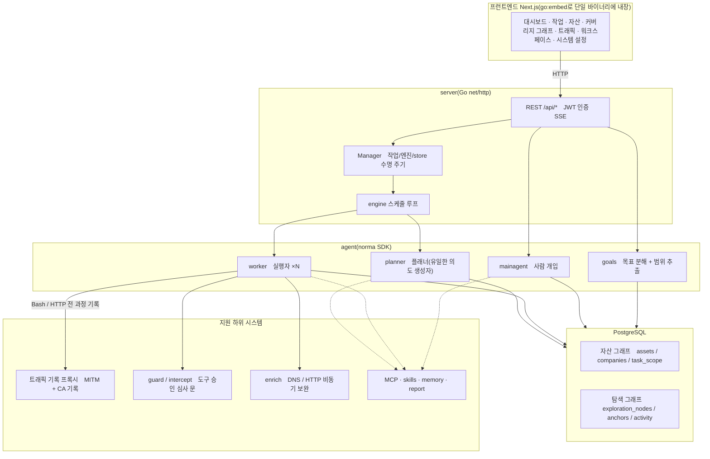
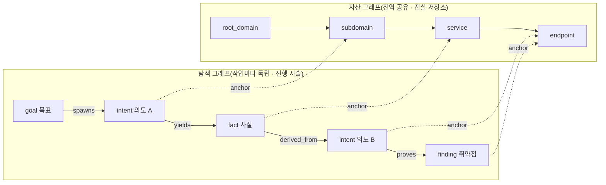
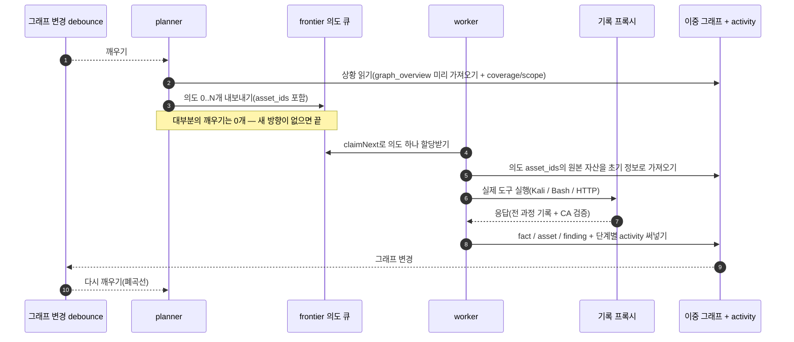
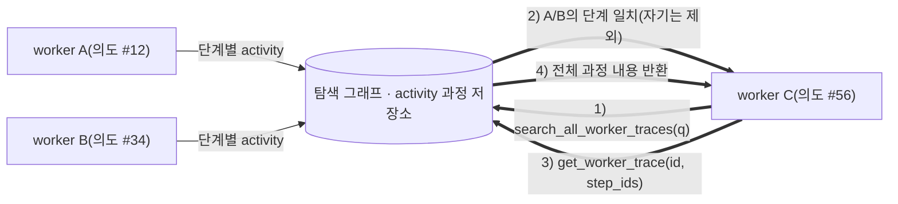
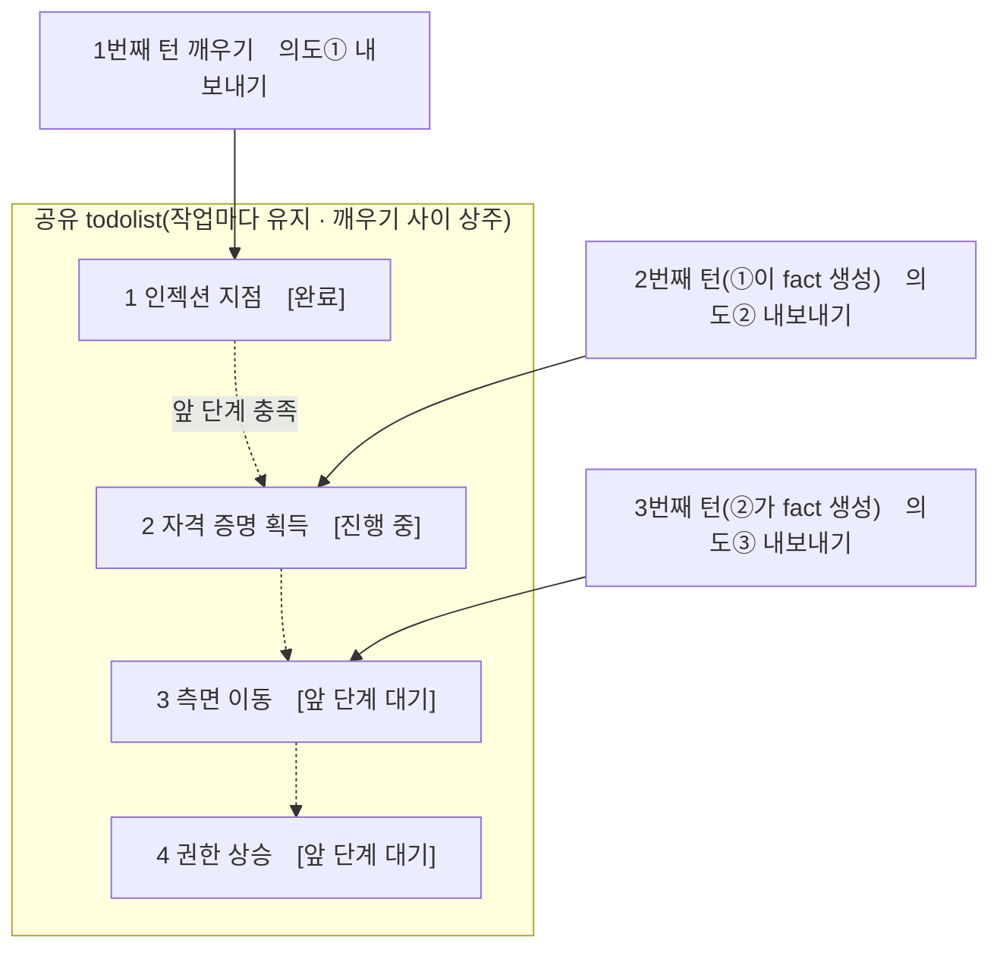

<div align="center">

# ARTEX

AI 자율 침투 테스트 시스템(Go 백엔드 + Next.js 프런트엔드)


🌐 **온라인 데모**: [https://artex-demo.vercel.app/](https://artex-demo.vercel.app/)

</div>

---

## 화면 미리 보기

> 전체 동작은 [온라인 데모](https://artex-demo.vercel.app/)에서 확인합니다.

| 대시보드(개요 / 토큰 사용량 / 활동 피드) | 작업 목록 |
| :---: | :---: |
|  |  |

| 작업 · 실행 과정(세션 / 도구 호출) | 탐색 경로 |
| :---: | :---: |
|  |  |

| 발견 사항 | 자산 |
| :---: | :---: |
|  |  |

| 자산 커버리지 그래프(포스 기반 배치 · 테스트 완료 강조 · 노드 접기·펼치기) |
| :---: |
|  |

| 트래픽 기록 | 사람이 개입하는 대화 |
| :---: | :---: |
|  |  |

| 에이전트 관리 | LLM 프로필 |
| :---: | :---: |
|  |  |

| 차단 승인 심사 | 백엔드 로그 |
| :---: | :---: |
|  |  |


---

## 승인 심사 기록 상세

전역 '승인 심사 기록', 작업 안의 '차단 승인 심사', 대화 속 승인 심사 카드는 모두 펼쳐서 상세를 볼 수 있다. 표시 구조는
[AegisHook의 승인 심사 상세 컴포넌트](https://github.com/RuoJi6/AegisHook/blob/main/web/src/components/CallDetail.vue)를 참고하고, ARTEX의 컴포넌트와 테마를 그대로 쓴다.


## 자산 동기화(ScopeSentry)

[ScopeSentry](https://github.com/Autumn-27/ScopeSentry)에서 자산 데이터를 바로 동기화해 중복 수집을 줄일 수 있다.

- '**자산 동기화**' 페이지에 ScopeSentry의 주소와 API Key를 입력해 데이터 소스를 연결한다.
- **프로젝트**나 **작업** 단위로 동기화할 대상과 자산 유형(도메인 / 하위 도메인 / IP / 포트 / 사이트 / 엔드포인트…)을 고른다.
- 한 번에 가져와 기업 자산 범위에 맞춰 묶으면, 바로 ARTEX의 자산 그래프에 들어가 에이전트가 탐색에 쓴다.

---

## Claude 구독 로그인

LLM 프로필에서 인증 방식을 **Claude 구독**으로 선택해 저장한 뒤 로그인한다. 새 탭에서 Claude 인증을 끝내고, 이동한 `http://localhost:53692/callback?…` 주소 전체 또는 `code#state`를 붙여 넣으면 연결된다. 콜백 주소의 연결 실패 화면은 정상이며 원격 서버에서도 같은 방법을 쓴다. 코드와 state는 다른 사람에게 공유하지 않는다.

연결 후 모델 목록 조회와 연결 테스트를 하고 사용할 모델을 고른다. 토큰은 서버에서 암호화 저장·자동 갱신하며 API 키나 사용자 지정 중계 주소를 쓰지 않는다. 인증 실패에는 한 번만 갱신·재요청하고 사용량 제한·서버 오류는 자동 재전송하지 않는다. 연결 해제와 재로그인은 같은 프로필 화면에서 한다.

OML에서 확인한 Claude Code 구독 OAuth 요청 조건을 적용한 기능이다. 제공자 정책·모델 권한은 달라질 수 있으므로 배포 전에 실제 구독 계정으로 로그인·연결 테스트·대화·연결 해제를 확인한다.

## 설치

> 데이터베이스 **PostgreSQL**이 필요하다. 탐색에는 **LLM** 설정이 필요하다(`ANTHROPIC_API_KEY` 또는 `OPENAI_API_KEY`, UI에서도 설정할 수 있다).

### 방법 1: 일괄 설치 스크립트(권장)

```bash
git clone https://github.com/LRTK-CODER/ARTEX.git
cd ARTEX
./install.sh
```

스크립트는 Docker를 감지한 뒤 **① 전부 Docker** 또는 **② 로컬 컴파일 실행**을 고르게 한다.

스크립트는 Docker를 설치하지 않는다. ① 또는 ②에서 Docker로 PostgreSQL을 띄우려면 먼저 [공식 설치 문서](https://docs.docker.com/engine/install/)대로 Docker와 Docker Compose 플러그인을 설치한다. 없으면 이 링크를 보여 주고 멈춘다.

- **① 전부 Docker**: Postgres 비밀번호를 하나 입력하면(엔터를 치면 무작위) `.env`를 자동으로 쓰고 `docker compose up -d`를 실행한다.
- **② 로컬 실행**: 데이터베이스를 고르고(기존 연결 / Docker로 하나 띄우기) `config.json`을 만든 뒤 `go`로 프런트엔드를 내장한 단일 바이너리를 컴파일해 실행한다.

설치가 끝나면 **http://localhost:8787**을 연다(처음에는 `/setup`에서 관리자 비밀번호를 설정한다).

### 방법 2: Docker Compose(수동)

```bash
git clone https://github.com/LRTK-CODER/ARTEX.git
cd ARTEX
cp .env.example .env          # POSTGRES_PASSWORD 입력, ANTHROPIC_API_KEY는 선택
docker compose up -d          # ghcr.io/lrtk-coder/artex 이미지 + postgres 받기
# → http://localhost:8787
```

이미지는 이 포크의 릴리스 워크플로가 GHCR(`ghcr.io/lrtk-coder/artex`)에 올린다. 첫 push 뒤 GitHub 패키지 설정에서 공개 범위를 정한다. 비공개로 두면 받기 전에 `docker login ghcr.io`가 필요하다.

이미지에는 자주 쓰는 도구(ripgrep/curl/vim/npm/nmap…)가 들어 있고, `./skills`·`./data`·`./keys`는 바인드 마운트로 보존된다.
서버는 root가 아닌 `artex`(uid·gid 10001)로 돌고, 루트 파일 시스템은 읽기 전용이다(`docker-compose.yml`의 `read_only: true`). 손으로 띄울 때는 `docker compose up -d` 전에 [Docker 볼륨 소유권](#docker-볼륨-소유권)대로 바인드 마운트 소유권을 맞춘다(`install.sh`·`update.sh`는 알아서 맞춘다).

### 서버 키 디렉터리와 백업

서버 키 `jwt.key`(웹 로그인 세션 서명)와 `oauth.key`(DB에 저장한 ChatGPT·Claude 구독 토큰 암호화)는 키 디렉터리에 둔다.

- 키 디렉터리는 환경 변수 `ARTEX_KEY_DIR`로 정한다. 비어 있으면 실행 파일 옆 디렉터리다. 상대 경로는 절대 경로로 바뀌고, 없으면 `0700`으로 만든다.
- 키 디렉터리가 작업 공간(`-data`, 기본 `data/`)과 같거나 그 안이면 서버가 시작하지 않는다. 작업 공간은 파일 관리자로 내려받을 수 있기 때문이다. 심볼릭 링크는 풀어서 비교한다.
- Docker 이미지는 `ARTEX_KEY_DIR=/app/keys`이고, `docker-compose.yml`이 프로젝트 루트의 `./keys`를 붙인다. 컨테이너를 다시 만들어도 키가 남는다.
- 키 디렉터리에 키가 없고 실행 파일 옆 디렉터리에 있으면, 시작할 때 키 디렉터리로 옮기고 원래 파일을 지운다.
- 키를 잃으면 웹 세션이 모두 끊기고 ChatGPT·Claude 구독 로그인을 다시 해야 한다. `./keys`(바이너리 설치는 키 디렉터리)를 `./data`·데이터베이스와 함께 백업한다.

**이전 Docker 설치를 올릴 때**: 예전 이미지는 키를 컨테이너 안 `/app/jwt.key`·`/app/oauth.key`에 두었다. 컨테이너를 다시 만들면(새 이미지 적용, `--force-recreate`) 이 파일은 사라지므로, 서버의 자동 이전은 같은 컨테이너를 재시작할 때만 효과가 있다.

- **먼저 `git pull --ff-only`를 하고, 그다음 `./update.sh`를 돌린다.** 새 `update.sh`는 컨테이너를 다시 만들기 전에 예전 컨테이너의 키를 `./keys`로 꺼낸다(이미 있는 키는 덮지 않음, 0600). 그래서 다시 로그인하지 않아도 된다. 꺼내다 실패하면 업그레이드를 멈춘다. 이미 배포된 곳에서 `git pull` 뒤 `./install.sh`를 다시 돌려도 같다.

  ```bash
  git pull --ff-only
  ./update.sh            # ① Docker
  ```

- **주의: 지금 가진 옛 `update.sh`를 바로 돌리면 키가 사라진다.** 옛 스크립트는 git pull로 새 파일을 받아도 이미 읽어 둔 옛 순서대로 컨테이너를 다시 만들고, 키를 꺼내지 않는다. 이미 그렇게 올렸다면 서버가 새 키를 만든 상태다. 웹에 다시 로그인하고, LLM 프로필에서 ChatGPT 구독 로그인을 다시 한다. 다음 업그레이드부터는 `update.sh`가 스스로 바뀐 것을 알아채고 새 스크립트로 다시 시작한다.
- 대안으로, 손으로 `docker compose pull`·`docker compose up -d --force-recreate`로 올릴 때는 먼저 키를 꺼내 둔다.

```bash
mkdir -p keys && chmod 700 keys
docker compose cp artex:/app/jwt.key keys/     # 없다고 나오면 건너뛴다
docker compose cp artex:/app/oauth.key keys/   # 구독 로그인을 쓰지 않았다면 없다
chmod 600 keys/*.key
docker compose pull artex && docker compose up -d --force-recreate artex
```

### Docker 볼륨 소유권

예전 이미지는 root로 돌아서 `./data`·`./keys`가 root 소유다. 지금 이미지는 `artex`(uid·gid 10001)로 돌므로 그대로 두면 서버가 작업 공간이나 키를 쓰지 못해 시작하지 못한다(로그에 `[config] 컨테이너 사용자(uid 10001)가 ./data·./keys를 읽거나 쓰지 못합니다`와 이 절을 가리키는 안내가 찍힌다). `./update.sh`(① Docker)와 `./install.sh`는 이미지를 받은 뒤 아래를 알아서 한다. 손으로 올릴 때는 compose 디렉터리에서 다음을 따른다.

| 경로 | 맞출 상태 | 이유 |
|---|---|---|
| `./data` | 10001:10001 소유 | 작업 공간. 서버가 쓴다 |
| `./keys` | 10001:10001 소유, 디렉터리 0700, 키 파일 0600 | 서버 키. 서버만 읽는다 |
| `./skills` | 소유자는 호스트 사용자 그대로, 그룹 10001, `g+rwX`, 디렉터리에 setgid | 호스트에서 `git pull`로 갱신하고, 화면·에이전트도 스킬을 만들고 고친다 |

```bash
docker compose pull artex
docker compose stop artex
# sudo 없이: 받은 이미지를 root로 한 번 띄워 바인드 마운트를 고친다
docker compose run --rm --no-deps --user 0:0 --entrypoint sh artex -c '
  set -e
  chown -R 10001:10001 /app/data /app/keys
  chmod 700 /app/keys
  find /app/keys -type f -exec chmod 600 {} +
  chgrp -R 10001 /app/skills
  chmod -R g+rwX /app/skills
  find /app/skills -type d -exec chmod g+s {} +'
docker compose up -d artex
```

호스트에서 sudo를 쓸 수 있으면 같은 일을 이렇게 해도 된다: `sudo chown -R 10001:10001 data keys && sudo chmod 700 keys && sudo find keys -type f -exec chmod 600 {} + && sudo chgrp -R 10001 skills && sudo chmod -R g+rwX skills && sudo find skills -type d -exec chmod g+s {} +`.

- 키를 아직 컨테이너 안(`/app/*.key`)에서 꺼내지 않은 예전 설치라면 [서버 키 디렉터리와 백업](#서버-키-디렉터리와-백업)의 키 꺼내기를 먼저 한다.
- 이전한 뒤 호스트 사용자는 `./data`·`./keys`를 sudo 없이 읽지 못한다. 백업은 `sudo`로 하거나 `docker compose cp`로 꺼낸다.
- 컨테이너가 `./skills`에 새로 만든 스킬(화면·에이전트)은 10001 소유, 그룹 10001에 그룹 쓰기 권한이다. git이 추적하는 파일은 호스트 사용자 소유 그대로라 `git pull`은 그대로 된다. 컨테이너가 만든 스킬을 호스트에서 고치려면 sudo를 쓰거나, 호스트에 gid 10001 그룹을 만들어 사용자를 넣는다(`sudo groupadd -g 10001 artex && sudo usermod -aG artex "$USER"`, 다시 로그인한 뒤 적용).
- nmap은 실행 파일에 `cap_net_raw`가 있어 root가 아니어도 SYN 스캔(`-sS`)과 OS 탐지가 된다(에이전트 uid 분리를 켜면 쓸 수 없다. [에이전트 uid 분리](#에이전트-uid-분리) 참고).

원격 MCP는 시스템 설정에서 `http`(Streamable HTTP) 또는 `sse`(이전 버전 SSE)를 고를 수 있다.
이전 버전 SSE 서비스는 보통 `GET /sse`로 이벤트 스트림을 열고, 서비스가 돌려주는
`/message?sessionId=...`로 JSON-RPC 요청을 받는다. 설정할 때는 URL에 `/sse`를 넣고, 요청 헤더에
`Authorization=Bearer <token>`을 넣는다.

### 방법 3: 미리 컴파일한 바이너리 내려받기(Releases)

[Releases](https://github.com/LRTK-CODER/ARTEX/releases)에서 플랫폼에 맞는 zip을 내려받아 풀면 `artex` + `start.sh`(Windows는 `start.bat`) + `skills/` + `config.example.json`이 나온다.

```bash
cp config.example.json config.json   # database 연결을 채운다
./start.sh                           # → http://localhost:8787
```

> `./artex`를 바로 실행하지 말고 `start.sh` / `start.bat`로 띄운다. 이것은 감시 스크립트로, 프로그램이 종료되면 종료 코드에 따라 다시 띄울지 정하고, **화면의 [원클릭 업데이트](#방법-1-화면-원클릭-업데이트-권장)가 이 스크립트로 교체를 끝낸다**. `./artex`를 바로 실행하면 업데이트 뒤에 다시 띄워지지 않는다.
> 백그라운드 상주: `nohup ./start.sh >artex.log 2>&1 &`.

### 방법 4: 소스에서 단일 바이너리 컴파일

```bash
# 1) 프런트엔드 정적 export
cd web && npm ci && npm run build:static && cd ..
# 2) 내장 디렉터리로 복사
cp -r web/out server/webui/dist
# 3) 컴파일(-tags embedui 를 줘야 프런트엔드를 내장한다)
CGO_ENABLED=0 go build -tags embedui -o artex ./cmd/artex
./start.sh
```

### 방법 5: 교차 플랫폼 Release 압축 파일 빌드

`build.sh`는 먼저 프런트엔드를 빌드해 내장한 뒤 Go 링커로 디버그 정보를 지우고 배포 파일을 zip으로 압축한다. Release 모드는 기본으로 Linux amd64/arm64, macOS amd64/arm64, Windows amd64의 zip을 만든다.

```bash
./build.sh --release
# 결과물: dist/artex-0.3.3-*.zip
```

UPX 자체 압축 해제 바이너리는 일부 Linux 커널, 가상화 환경, 보안 정책과 맞지 않을 수 있어 기본으로 켜지 않는다. `ARTEX_TARGETS`로 대상을 지정할 수 있고, 대상 실행 환경이 호환되는 것을 확인하면 `--upx`를 명시해 바이너리를 더 줄일 수 있다.

```bash
ARTEX_TARGETS=linux/amd64,windows/amd64 ./build.sh --release
./build.sh --target linux/amd64 --upx
```

---

## 업데이트

> 업데이트는 프로그램만 바꾸고 데이터는 건드리지 않는다. Postgres 데이터 볼륨 `pgdata`, `./data`(SQLite 등), `./keys`(jwt.key / oauth.key), `./skills`는 모두 유지된다. **데이터베이스 마이그레이션은 손으로 실행하지 않아도 된다.** `artex`는 시작할 때마다 `schema.sql`(`ADD COLUMN` / `CREATE INDEX IF NOT EXISTS` 포함)을 멱등하게 다시 돌린다. 곧 '다시 시작하면 마이그레이션'이다. 그래도 업데이트 전에는 `./data`·`./keys`와 데이터베이스를 먼저 백업하는 것이 좋다. 키 파일이 아직 컨테이너 안에 있는 이전 버전 Docker에서 올릴 때는 [서버 키 디렉터리와 백업](#서버-키-디렉터리와-백업)을 본다.

### 방법 1: 화면 원클릭 업데이트(권장)

**시스템 설정** 페이지(사이드바 '시스템 설정' → `/system/settings`)의 **버전과 업데이트** 카드에서 서버에 로그인하지 않고도 새 버전을 바로 확인하고 설치할 수 있다. 단독 실행 파일(Releases, 소스 컴파일) 배포에서만 쓴다. Docker는 아래 Docker 항목을 본다.

'업데이트'를 누르면 현재 플랫폼의 배포 파일을 내려받아 Release의 `SHA256SUMS`와 대조하고, `-h`로 새 바이너리를 스모크 테스트한 뒤 `artex.new`로 임시 저장한다. 그다음 프로그램이 종료되면 `start.sh` / `start.bat`이 다시 띄우며 교체를 끝낸다. 화면은 새 버전이 올라올 때까지 기다렸다가 자동으로 새로 고친다.

- **실패해도 망가진 프로그램이 남지 않는다**: 검증이나 스모크 테스트를 통과하지 못하면 임시 파일을 버리고 현재 버전을 계속 돌린다. 교체한 새 버전이 3번 연속으로 시작에 실패하면 `artex.old`로 자동 롤백한다(실패한 것은 조사용으로 `artex.failed`로 남긴다).
- **언제든 되돌릴 수 있다**: 이전 버전은 `artex.old`로 남고, 카드에 '이전 버전으로 롤백'이 있다. 단, 데이터베이스 구조는 되돌아가지 않는다.
- **업데이트는 실행 중인 작업을 중단한다**: 업데이트가 곧 다시 시작이므로 쉴 때 한다.
- **개발 빌드에는 업데이트를 주지 않는다**: 버전 번호가 `dev`이거나 `git describe`에 접미사가 붙으면 비활성화해, 정식 버전이 로컬에서 디버깅하는 바이너리를 덮어쓰지 않게 한다.
- **Docker에서는 원클릭 업데이트를 쓰지 않는다**: 카드는 새 버전 알림만 보이고 적용·롤백 버튼 대신 이미지 교체 명령을 안내한다(API도 적용·롤백을 409로 거부한다). 이미지가 `/app`을 root 소유 읽기 전용으로 두고 서버를 root가 아닌 사용자로 돌려, 프롬프트 주입을 당한 에이전트가 서버 바이너리를 바꾸지 못하게 하기 때문이다. 아래 방법 2(①) 또는 방법 3으로 `docker compose pull artex && docker compose up -d artex`를 쓴다.
- GitHub 접속에 프록시가 필요하면 같은 페이지에서 **전역 프록시**를 설정하면 업데이트 경로가 그것을 쓴다. 업데이트는 GitHub 도메인에서만 내려받고 HTTPS를 강제한다.

### 방법 2: 일괄 업데이트 스크립트

```bash
cd ARTEX
git pull --ff-only   # 먼저 받는다. 옛 update.sh 로 바로 올리면 서버 키를 잃는다(아래 참고)
./update.sh
```

스크립트는 먼저 선택적으로 `git pull`로 최신 코드를 받고, **① Docker 업데이트** 또는 **② 로컬 컴파일 업데이트**를 고르게 한다(`install.sh`와 같다).

- **① Docker**: 대상 이미지 태그를 지정할 수 있고(엔터를 치면 `.env`의 `ARTEX_TAG`를 쓰고, 없으면 `latest`), `docker compose pull` → `docker compose up -d`를 실행한다(새 이미지로 다시 시작하면 자동으로 마이그레이션한다).
  - 컨테이너를 다시 만들기 전에 예전 컨테이너의 서버 키를 `./keys`로 꺼낸다. 이 단계가 없는 옛 `update.sh`로 바로 올리면 키를 잃으므로 먼저 `git pull --ff-only`를 한다. 자세한 것은 [서버 키 디렉터리와 백업](#서버-키-디렉터리와-백업).
  - git pull이 `update.sh`를 바꾸면 고른 메뉴 그대로 새 `update.sh`로 다시 시작한다. git pull 질문에 `n`이라고 답하면 지금 코드로 업데이트를 이어 간다.
- **② 로컬**: 프런트엔드 정적 결과물을 다시 빌드하고 `./artex`를 다시 컴파일한다(끝나면 프로세스를 다시 시작해 적용한다).

### 방법 3: Docker Compose(수동)

```bash
cd ARTEX
git pull                       # compose / 스크립트 업데이트(선택)
# 키가 아직 컨테이너 안(/app/*.key)에 있는 예전 설치는 여기서 먼저 키를 ./keys 로 꺼낸다(서버 키 디렉터리와 백업 절 참고)
# 버전 지정: .env 에 ARTEX_TAG=v0.2.0 설정, 설정하지 않으면 latest
docker compose pull artex
# root로 돌던 예전 이미지에서 처음 올릴 때는 여기서 볼륨 소유권을 맞춘다(Docker 볼륨 소유권 절 참고)
docker compose up -d artex     # 새 이미지로 다시 시작 → schema 자동 마이그레이션
docker image prune -f          # 옛 이미지 정리(선택)
```

### 방법 4: 미리 컴파일한 바이너리(Releases)

[Releases](https://github.com/LRTK-CODER/ARTEX/releases)에서 새 버전 zip을 내려받고, 옛 프로세스를 멈춘 뒤 `artex`와 `skills/`를 덮어쓰면 된다(`config.json`과 `data/`는 그대로 둔다). 그다음 다시 시작한다.

```bash
cp -r <압축 푼 디렉터리>/skills ./ && cp <압축 푼 디렉터리>/artex ./
./start.sh
```

### 방법 5: 소스에서 컴파일

```bash
git pull
cd web && npm ci && npm run build:static && cd ..
cp -r web/out server/webui/dist
CGO_ENABLED=0 go build -tags embedui -o artex ./cmd/artex
# ./start.sh 다시 시작
```

---

## 설정

**데이터베이스**(`config.json`, 또는 환경 변수 `ARTEX_PG_DSN`으로 덮어쓰기):

```json
{
  "database": {
    "host": "127.0.0.1", "port": 5432,
    "user": "artex", "password": "yourpass",
    "dbname": "artex", "sslmode": "disable"
  }
}
```

**LLM**: `export ANTHROPIC_API_KEY=sk-...`(또는 `OPENAI_API_KEY`), UI의 'LLM 프로필' 페이지에서도 입력할 수 있다.
선택: `ARTEX_LLM_PROVIDER` / `ARTEX_LLM_MODEL` / `ARTEX_LLM_BASE_URL` / `ARTEX_LLM_PROXY`.

**동시 실행**: 작업마다 띄우는 work 에이전트 수는 '시스템 설정'에서 설정한다(기본값 3).

**자주 쓰는 파라미터**: `./start.sh -addr :8787 -proxy :8788`(`-addr`는 프런트엔드+API, `-proxy`는 트래픽 기록 프록시). 시작 스크립트는 파라미터를 `artex`에 그대로 넘긴다.

### 에이전트 uid 분리

Linux에서만 쓰는 기본 꺼짐 기능이다. 켜면 에이전트가 실행하는 명령(Bash 동기·백그라운드, shell_open, 사용자 지정 도구의 command·python, stdio MCP)이 서버와 다른 uid로 돈다. 프롬프트 주입을 당한 에이전트가 서버 키(`<키 디렉터리>/oauth.key`), 서버 프로세스 환경(`/proc/<서버 pid>/environ`의 DB DSN·API 키), 실행 파일 옆 업데이트 경로에 닿지 못하게 한다.

- 켜기: 환경 변수 `ARTEX_AGENT_UID`·`ARTEX_AGENT_GID`를 함께 준다(공용 에이전트 사용자). 허용 범위는 20000-29999이고 도우미 코드에 고정돼 있다(0과 서버 자신의 uid·주 그룹은 거부한다). 서버는 그 그룹에 보조 그룹으로 속해야 한다. 작업·대화형 세션의 명령은 아래 "작업별 uid"의 uid와 이 gid로 돈다. 공용 uid는 작업·세션에 속하지 않는 명령(설정 화면의 MCP 도구 목록 조회, 사용자 지정 도구 시험 실행)에만 쓴다. 서버는 자기 검사 뒤 이 두 변수를 자기 프로세스 환경에서 지운다.
- 동작: 서버가 시작할 때 도우미 `artex-sandbox`(실행 파일 옆)로 자기 검사를 하고, 서버의 PATH를 셸 대체 디렉터리(`<실행 파일 디렉터리>/artex-shell`) 하나로 바꾼다. 그 안의 `bash`는 도우미를 가리키는 링크다. 원래 PATH는 `ARTEX_AGENT_PATH`로 넘긴다. 도우미는 보조 그룹을 비우고 uid·gid를 바꾼 뒤 cap을 모두 버리고 `no_new_privs`를 켜고, 원래 PATH와 umask 002로 진짜 bash(또는 명령)를 실행한다. 셸 대체 링크가 없어지면 에이전트 명령은 bash를 찾지 못해 실패한다. 서버 uid로 실행되지 않는다.
- 작업 공간: 켜면 planner·mainagent의 작업 디렉터리는 `tasks/<id>/work`다(끄면 예전처럼 `tasks/<id>`). 에이전트 그룹은 작업 공간 디렉터리(`sessions/<id>`, `tasks/<id>/work`, `tasks/<id>/i<id>`)와 그 안에만 쓸 수 있다. 그 위(`<데이터 디렉터리>`, `tasks`, `sessions`, `drafts`, `tasks/<id>`)와 `drafts` 아래, `tasks/<id>` 아래의 다른 디렉터리(첨부 `uploads`, 큰 출력 `cmd-output`, 끄고 쓰던 동안 생긴 디렉터리)와 그 안은 읽고 지나가기만 한다. 서버를 다시 시작해 권한을 맞출 때도 같다. 그래서 에이전트는 서버가 만든 작업 공간(`work`, `i<id>`)과 `uploads`를 옮기거나 그 자리에 링크를 두지 못하고, 첨부 파일을 고치지 못한다. 작업 공간은 에이전트 그룹의 setgid 디렉터리라 서버와 에이전트가 서로 만든 파일을 읽고 고친다. sticky 비트는 쓰지 않는다(`fs.protected_regular=2`인 호스트에서 서버가 에이전트가 만든 파일을 다시 쓰지 못하게 된다).
- 큰 도구 출력: 켜면 norma가 큰 출력을 쓰는 곳은 작업 공간 밖의 서버 전용 디렉터리(`tasks/<id>/cmd-output/<work|i<id>>`, `sessions/cmd-output/<id>`)다. 에이전트는 읽기만 한다(Bash의 `sed`·`grep`, 파일 도구 Read). 끄면 예전처럼 작업 디렉터리 안의 `cmd-output`이다.
- 파일 도구: 켜면 Read·Write·Edit·MultiEdit는 허용 디렉터리 안에서 대상 파일을 링크를 따라 밖으로 나가지 않게 연 뒤 그 파일만 다룬다. LS·Glob·Grep은 도구 목록에서 빠진다. 디렉터리를 걷는 도중 에이전트가 항목을 링크로 바꾸면 서버 uid가 따라가기 때문이다. 에이전트는 Bash(에이전트 uid)의 `rg`·`grep`·`find`·`ls`로 같은 일을 한다. Docker 이미지에는 넷 다 있다. 단일 바이너리는 호스트에 있는 것을 쓴다.
- 켰는데 준비하지 못하면(Linux가 아님, 도우미가 없음, 파일 cap이 없음, `no-new-privileges`, 서버에 `CAP_KILL`이 없음, 셸 대체 디렉터리가 조건에 맞지 않음, 데이터 디렉터리가 POSIX ACL을 지원하지 않음) 원인을 찍고 시작하지 않는다. 조용히 꺼지지 않는다. 셸 대체 디렉터리는 링크가 아니고, root나 서버 소유이고, 그룹·다른 사용자 쓰기가 없고, `bash`가 도우미를 가리켜야 한다. 데이터 디렉터리(`-data`)는 ACL을 지원하는 파일 시스템(ext4·xfs·btrfs·tmpfs 등, 일부 NFS·FUSE는 지원하지 않는다)에 둔다. 서버는 시작할 때 데이터 디렉터리 안에 빈 디렉터리(`.acl-check-*`)를 잠깐 만들어 에이전트 uid 항목이 든 접근·기본 ACL을 쓰고 다시 읽어 확인한 뒤 지운다(작업 공간을 작업마다 나누는 데 쓴다, #182).
- 작업별 uid(#166, #177): 켜면 작업과 대화형 세션마다 uid 풀(20001-21024, 1024개)에서 겹치지 않는 uid 하나를 DB(`agent_uids`)에 할당하고, 그 작업·세션의 에이전트 명령(Bash 동기·백그라운드, shell_open, 사용자 지정 도구의 command·python, stdio MCP)을 그 uid로 실행한다. gid는 아직 공용 에이전트 그룹(`ARTEX_AGENT_GID`)이라 작업 공간은 지금처럼 함께 쓴다(작업 공간을 작업마다 나누는 것은 #182). uid가 다르므로 다른 작업·세션의 프로세스에 신호를 보내거나 `/proc/<pid>/environ`·`cwd`·`fd`를 읽지 못한다. 작업은 처음 실행할 때(메인 에이전트 대화 포함), 대화형 세션은 첫 차례에 받는다. 재시작·보관·복원 동안 그대로 두고, 작업·세션을 지울 때 돌려준다. uid를 받지 못하면 그 실행은 원인이 적힌 오류로 멈추고, 공용 uid나 서버 uid로 돌지 않는다. 풀이 바닥났으면 작업은 실패로 끝나고 대화 차례는 오류로 끝난다. DB 연결이 잠깐 끊긴 것 같은 그 밖의 오류는 작업 상태를 바꾸지 않는다. 작업은 시작하지 않은 채 5초에서 시작해 최대 60초 간격으로 다시 받고, 받으면 시작한다. 그동안 작업 활동에 원인과 다음 시도 시각이 한 번 남고, 일시 중지·삭제·서버 종료로 다시 받기를 멈춘다. 대화 차례와 메인 에이전트 대화는 오류로 끝나고 다음에 보낼 때 다시 받는다. 실행 중에(계획·의도 실행을 시작할 때) 받지 못하면 그 의도는 오류로 끝난다(blocked). 풀 사용자의 passwd·group 항목(`artex-agent-<uid>`, 셸 nologin, 홈 없음)은 Docker 이미지에 들어 있고, 단일 바이너리는 `sudo ./agent-pool-users.sh`(저장소 루트와 Linux 릴리스 zip에 있다. `install.sh`의 로컬 설치가 Linux에서 묻는다)로 만든다. 공용 에이전트 사용자 20000은 풀에 넣지 않는다.
- 켜면 raw 소켓이 필요한 스캔(`nmap -sS`, `-O` 등)은 쓸 수 없다. `nmap -sT`(연결 스캔)를 쓴다. 도우미가 `NMAP_PRIVILEGED`를 지워 nmap이 연결 스캔을 기본으로 고른다.
- 컨테이너 설정이 도우미의 파일 cap을 막으면(`cap_drop`으로 `SETUID`·`SETGID`·`KILL`을 뺌) 커널이 도우미 실행 자체를 거부해 엔트리포인트가 `exec: /app/artex-sandbox: Operation not permitted` 한 줄을 남기고 멈춘다. 이 줄이 보이면 `cap_drop`을 확인한다.

Docker: 이미지에 도우미(`0750 root:artex`, `cap_kill,cap_setuid,cap_setgid+ep`), 셸 대체 디렉터리 `/app/artex-shell`(root 소유), 에이전트 사용자 `artex-agent`(uid·gid 20000)가 들어 있다. `.env`에 `ARTEX_AGENT_UID=20000`, `ARTEX_AGENT_GID=20000`을 두고 `docker compose up -d`. 이 두 값이 있으면 엔트리포인트가 `artex-sandbox launch`로 `CAP_KILL`만 ambient에 올려 서버를 띄운다. 서버 실행 파일에는 파일 cap이 없다. 파일 cap이 있으면 커널이 secure-exec로 실행해 Go 런타임이 패닉 추적을 지우기 때문이다. 그래서 끈 상태의 서버 실행은 이 기능이 없을 때와 같다. 다만 이미지에는 도우미가 들어 있고 서버 사용자 `artex`가 그 그룹에 속해(보조 그룹 `artex-agent`도 붙는다) 끈 상태에서도 같은 uid인 에이전트가 도우미를 실행할 수 있다. 이때 얻는 것(`launch`의 ambient `CAP_KILL`, `exec`로 20000-29999 uid 되기)은 컨테이너 안의 다른 프로세스가 모두 같은 uid라 거의 쓸모가 없다. 켜면 엔트리포인트(PID 1의 `start.sh`)와 그 자식이 ambient `CAP_KILL`을 가진다. 서버는 시작할 때 비우고, 에이전트 프로세스는 0이다. 켤 때 `GOTRACEBACK`을 환경 변수로 주면 도우미를 지나며 지워진다(기본값으로 돈다). `security_opt: [no-new-privileges:true]`를 쓰지 않고, `cap_drop`을 쓰면 `SETUID`·`SETGID`·`KILL`을 남긴다. 켠 뒤 `./data` 아래 작업 공간 디렉터리의 그룹은 20000이 된다.

단일 바이너리(systemd): 에이전트 사용자를 만들고, 서버 사용자를 그 그룹에 넣고, root로 도우미에 cap을 준다. 서버에는 `CAP_KILL`을 ambient로 준다. 다른 uid가 된 에이전트 프로세스를 시간 초과·TaskStop·shell_close에서 죽이는 데 필요하다. 서버 실행 파일에 파일 cap을 주지 않는 이유는 위의 패닉 추적 문제와, 원클릭 업데이트로 바이너리가 바뀌면 cap이 사라지기 때문이다. 셸 대체 디렉터리 `/opt/artex/artex-shell`은 처음 켤 때 서버가 0750으로 만든다(실행 파일 디렉터리에 서버 쓰기 권한이 있어야 한다. 없으면 아래처럼 root로 미리 만든다). 원클릭 업데이트는 `artex`만 바꾸고 도우미는 바꾸지 않는다. 도우미가 바뀐 릴리스에서는 아래 설치를 다시 한다.

```bash
sudo groupadd --system --gid 20000 artex-agent
sudo useradd --system --uid 20000 --gid artex-agent --create-home --shell /usr/sbin/nologin artex-agent
sudo usermod -aG artex-agent artex            # 서버를 돌리는 사용자
cd /opt/artex                                  # artex와 artex-sandbox가 있는 디렉터리
sudo chown root:artex artex-sandbox && sudo chmod 0750 artex-sandbox
sudo setcap cap_setuid,cap_setgid+ep artex-sandbox
# 선택: 실행 파일 디렉터리에 서버 쓰기 권한이 없으면 셸 대체 디렉터리를 미리 만든다
sudo mkdir -m 0750 artex-shell && sudo ln -s /opt/artex/artex-sandbox artex-shell/bash && sudo chown -h root:artex artex-shell artex-shell/bash
```

```ini
# /etc/systemd/system/artex.service
[Unit]
Description=ARTEX
After=network-online.target postgresql.service

[Service]
User=artex
WorkingDirectory=/opt/artex
ExecStart=/opt/artex/start.sh -addr :8787 -proxy 127.0.0.1:8788
Environment=ARTEX_AGENT_UID=20000 ARTEX_AGENT_GID=20000
EnvironmentFile=-/opt/artex/artex.env          # ARTEX_PG_DSN, API 키(0600)
AmbientCapabilities=CAP_KILL
# NoNewPrivileges=yes와 이를 켜는 설정(SystemCallFilter=, RestrictNamespaces= 등)을 쓰지 않는다. 도우미의 파일 cap이 무시된다.
Restart=on-failure

[Install]
WantedBy=multi-user.target
```

서버는 시작할 때 `CAP_KILL`을 effective로만 남기고 ambient·inheritable을 비운다. 그래서 서버가 감싸지 않고 띄우는 자식(ripgrep 등)은 `CAP_KILL`을 물려받지 않는다. 도우미는 cap을 모두 버리므로 에이전트로 새지 않는다.

한계:
- 파일 도구(Read/Write/Edit/MultiEdit)는 여전히 서버 uid로 돈다. 작업 공간 경로 제한과 위의 열기 방식이 막는다. 켜면 LS·Glob·Grep 도구 대신 셸 명령을 쓴다.
- 파일 도구의 허용 경로에는 모든 역할에 시스템 임시 디렉터리(`$TMPDIR`, 보통 `/tmp`)가 들어 있다(#169). 파일 도구는 서버 uid로 돌기 때문에, 켜도 임시 디렉터리 아래의 서버 전용 파일(발견 사항 내보내기 임시 파일, 다른 세션의 백그라운드 명령 출력 등)을 읽고 덮어쓸 수 있다. 에이전트 셸 명령은 이 파일에 닿지 못한다. 키 디렉터리(`ARTEX_KEY_DIR`)와 작업 공간(`-data`)을 임시 디렉터리 아래 두지 않는다.
- 끈 상태(에이전트가 서버와 같은 uid)에서 큰 출력 디렉터리(`cmd-output`)에 생긴 링크는 켤 때 지우지 않는다. 켠 뒤 서버가 같은 이름으로 출력을 쓰면 그 링크를 따라간다. 끈 상태의 에이전트는 이미 키에 닿을 수 있었으므로, 켜기 전에 쓰던 작업이 있으면 켤 때 서버 키를 새로 만든다(키 파일을 지우고 다시 시작하면 새로 생기고, 웹 세션과 구독 로그인이 풀린다).
- 서버 uid 코드가 작업 공간에 쓰는 다른 곳: python 도구 스크립트(`.tools`)는 작업 디렉터리 밖으로 나가는 링크를 따라가지 않고 무작위 이름으로 새로 만든다. 첨부 업로드와 웹 작업 공간 화면(`/api/workspace/*`)은 데이터 디렉터리 안에서만 링크를 따라간다(키 디렉터리는 데이터 디렉터리 밖이다). 그래서 에이전트가 작업 공간에 데이터 디렉터리 안의 다른 파일을 가리키는 링크를 두고 사용자가 웹 화면에서 그 파일을 고치면, 링크 대상이 바뀐다.
- 에이전트는 다음 의도 이름(`tasks/<id>/i<다음 번호>`)을 미리 둘 수 없다(`tasks/<id>`에 쓰지 못한다). 기능을 켜기 전(에이전트가 서버와 같은 uid)에 그 자리에 링크나 파일이 생겼으면 그 의도는 "refusing"으로 실패하고 링크는 따라가지 않는다.
- 셸 대체 디렉터리를 실행 중에 바꾸려면 서버 uid나 root 권한이 필요하다. 시작할 때만 확인한다.
- 작업 공간은 공용 에이전트 그룹으로 함께 쓰므로 작업 A의 에이전트는 작업 B·다른 세션의 작업 공간과 큰 출력을 읽고 쓸 수 있다(작업별 ACL은 #182). 같은 커널·네트워크 이름공간을 쓰므로 서버 포트·트래픽 기록 프록시에는 그대로 닿는다. 데이터 디렉터리의 다른 사용자 읽기 권한이 있는 항목(대화 기록 `transcripts`, `archives`, `traffic`)은 에이전트도 읽는다. 기록 프록시 CA 개인 키(`traffic/_ca/mitmproxy-ca.pem`)는 서버만 읽는다(0600).
- 에이전트가 자기 디렉터리를 0700으로 바꾸면 서버가 그 안을 지우지 못할 수 있다.
- 켜면 Monitor 도구는 실행되지 않는다(백그라운드 Bash를 쓴다). norma의 Monitor가 실행의 uid(`ToolContext.Env`)를 넘기지 않아 도우미가 `ARTEX_AGENT_UID is not set`으로 거부한다. 공용 uid나 서버 uid로 돌지 않는다. 모델에게는 "Started monitor"가 돌아가고, 그 작업의 출력과 상태(failed)에 거부가 남는다.

### 리버스 프록시 배포(HTTPS / 443만 열기)

프런트엔드와 API/SSE는 모두 같은 백엔드 포트(기본 `:8787`)가 제공하고, 실시간 활동 피드는 기본으로 **같은 출처** 주소를 쓴다. 그래서 **`NEXT_PUBLIC_SSE_BASE`를 설정하지 않아도 되고**, 공개망에는 443만 열고 8787은 내부망에 두면 된다.

SSE는 장시간 연결 + 지속 전송이므로 리버스 프록시에서 **버퍼링을 반드시 꺼야 한다**. 끄지 않으면 브라우저가 연결은 되어도 이벤트를 받지 못한다(활동 피드가 계속 도는 것으로 나타난다). Nginx 예시:

```nginx
server {
    listen 443 ssl;
    server_name your.domain.com;
    # ssl_certificate / ssl_certificate_key ...

    location / {
        proxy_pass http://127.0.0.1:8787;
        proxy_set_header Host $host;
        proxy_set_header X-Forwarded-Proto $scheme;

        # SSE 핵심 항목: 버퍼링 끄기, 긴 타임아웃, HTTP/1.1
        proxy_buffering off;
        proxy_cache off;
        proxy_read_timeout 3600s;
        proxy_http_version 1.1;
        proxy_set_header Connection "";
    }
}
```

> SSE가 페이지와 다른 출처(예: 별도 하위 도메인)를 써야 할 때만 **빌드 시점**에 `NEXT_PUBLIC_SSE_BASE`를 설정한다(이 변수는 `next build` 때 정적 패키지에 고정되므로, 컨테이너 실행 중에 설정해도 적용되지 않는다).

---


## 개발

### 수동 취약점 재검사

작업 상세의 '재검사' 탭에서 이 작업의 취약점을 페이지별로 골라 지난 판정과 증거를 보고, 손으로 재검사를 시작할 수 있다. 시작하면 현재 탭을 그대로 두고 도는 아이콘과 '재검사 중'을 보여 준다. 수정이 확인되면 취약점 상태를 함께 바꾼다.

취약점 목록의 각 행 관리 영역에서 '재검사'를 누르거나, 취약점 상세의 '취약점 재검사' 영역에서 '재검사 시작'을 누르고 선택 항목인 수정 버전·테스트 조건·제약을 입력하면, 시스템이 독립된 재검사 에이전트 세션을 만든다. 시작한 뒤에는 현재 페이지를 그대로 둔다. 목록의 평면 보기, 작업별 그룹 보기, 자산 보기 모두 이 입구를 지원한다. 재검사가 돌 때는 도는 아이콘과 '재검사 중'을 보여 주고, 보려면 눌러 해당 세션으로 들어가며, 끝나면 '재검사'로 돌아간다. 재검사는 원래 스캔 작업을 다시 시작하지 않아도 되고, 판정은 '여전히 재현됨'·'수정됨'·'확인 불가'로 나뉘며, 매번의 판정·증거·세션 링크는 취약점 상세에 저장된다.

새 버전 백엔드는 처음 시작할 때 편집할 수 있는 '취약점 재검사'(`retester`) 에이전트를 미리 넣어 둔다. 에이전트 관리에서 프롬프트·LLM·실행 단계 한도·도구를 설정할 수 있다. 기본으로는 연결된 LLM을 쓰고, 연결하지 않았으면 전역 활성 프로필을 쓴다. 재검사 세션이 성공으로 끝나고 판정이 '수정됨'이면, 시스템이 취약점 처리 상태를 자동으로 '수정됨'으로 바꾼다. 실행 중·실패·중지·그 밖의 판정은 원래 상태를 유지한다. 원본 증거와 보고서는 항상 남는다. 상태 드롭다운에서 손으로 '수정됨'을 고를 수도 있다. 같은 취약점을 재검사하는 중이면 기존 세션을 다시 쓰고, 중지·실패·서비스 재시작 뒤에는 다시 시작할 수 있다.

이 버전의 기록은 취약점 상세와 세션에서 볼 수 있고, 아직 취약점 보고서 내보내기나 작업 보관 파일에는 넣지 않으며 트래픽 기록도 자동으로 연결하지 않는다. 데모 모드는 명확히 표시한 모의 기록만 만들고 실제 대상에는 요청하지 않는다.

### 로컬 실행과 테스트

```bash
./dev.sh    # 백엔드(:8787) + 트래픽 프록시(:8788) + 프런트엔드 next dev(:5173) → http://localhost:5173
```

- 백엔드: `go run ./cmd/artex`(`-tags embedui`를 주지 않으면 프런트엔드를 내장하지 않는다)
- 프런트엔드: `cd web && npm run dev`(`/api`를 백엔드로 리버스 프록시, 핫 리로드 포함)
- 테스트: `go test ./...`
- Mock 미리 보기(백엔드 없음): `cd web && NEXT_PUBLIC_MOCK=1 npm run dev`

---

## 시스템 기술 아키텍처

ARTEX는 **LLM 멀티 에이전트가 이끄는 자율 침투 시스템**이다. Go 모놀리식 백엔드(Next.js 프런트엔드 내장) + PostgreSQL로 되어 있고, 에이전트 기능은 [`norma`](https://github.com/Autumn-27/norma) SDK가 제공한다(`agentcore` / `tool` / `permission` / `harness` / `memory` / `transcript`). 핵심은 **이중 그래프 아키텍처**와, 그것을 둘러싼 두 자율성 메커니즘, 곧 **worker 사이의 과정 단위 정보 교환**과 **planner의 여러 턴에 걸친 공유 todolist로 안정적인 공격 경로를 만드는 방식**이다.

### 전체 계층



| 계층 | 역할 |
| --- | --- |
| **프런트엔드** | Next.js 정적 export, `go:embed`로 단일 바이너리에 내장. 작업/자산/탐색 경로/커버리지 그래프를 시각화하고 사람이 개입하는 대화를 지원 |
| **server** | `net/http` 라우팅 + JWT 인증 + SSE. `Manager`가 작업·엔진·DB store의 수명 주기를 관리 |
| **engine** | 작업마다 `plannerLoop` 하나 + worker goroutine N개. 의도 할당받기, 시간 초과/일시 중지/drain |
| **agent** | goals / planner / worker / mainagent. `ToolSet`이 이중 그래프를 LLM 도구로 드러냄 |
| **db** | 이중 그래프의 Postgres 저장(pgx). schema는 `go:embed`로 시작할 때마다 멱등하게 테이블을 만듦 |
| **지원** | 기록형 MITM 프록시, 승인 심사 문, 비동기 보완, MCP/스킬/메모리/보고서 |

### 이중 그래프 아키텍처: 탐색 그래프 + 자산 그래프

시스템은 '**대상이 무엇인가**'와 '**어느 정도까지 테스트했는가**'를 서로 독립적이면서 앵커로 이어진 두 그래프로 나눈다.

- **자산 그래프(Asset Graph, 전역 공유)**: 작업을 넘나들며 같은 하나로 쓰는 자산 진실 저장소. 노드는 `root_domain / subdomain / ip / service / app / endpoint`이고 기업에 소속된다. 도메인→하위 도메인→서비스→엔드포인트의 부모·자식 관계와 중복 제거 key는 모두 프로그램이 계산하고, 에이전트는 원본 정보만 제출한다.
- **탐색 그래프(Exploration Graph, 작업마다 독립)**: 한 작업의 '생각과 진행' 과정. 노드는 `goal(목표) / intent(의도) / fact(사실) / finding(취약점) / hint(힌트)`이고, `spawns / derived_from / yields / proves` 같은 엣지로 **계보 사슬**을 이뤄, '어느 방향이 어떤 사실에서 파생했고 무엇을 만들어 냈는가'에 답한다.
- **두 그래프는 앵커로 이어진다**: `exploration_anchors(node_id, asset_id)`가 의도/사실/취약점을 구체적인 자산에 앵커로 건다. 그래서 '탐색 방향'에서 그것이 어느 자산을 겨냥하는지 볼 수도 있고, '어떤 자산'에서 그 자산이 이 작업에서 어떤 의도로 테스트됐고 어떤 사실을 얻었는지 거꾸로 찾을 수도 있다. 이것이 **자산 테스트 커버리지**와 **자산 커버리지 그래프**(범위 안 자산 + 테스트 완료 강조)를 뒷받침한다.



> 역할 분담: **planner**는 탐색 그래프 상황을 읽고 목표를 판단하며, 아직 커버하지 않은 새 방향이 있을 때만 **의도**를 frontier에 내보낸다. **worker**는 **의도 하나**를 할당받아 실제 도구로 실행하고, 새 자산/사실/취약점을 두 그래프에 쓴 뒤 멈춘다. 자산 그래프는 공유된 사실이고, 탐색 그래프는 작업마다의 진행 사슬이다.

### 엔진과 의도 수명 주기(한 번의 탐색 폐곡선)

엔진은 **이벤트 기반** 폐곡선이다. 그래프가 바뀌면 planner를 깨우고, planner가 의도를 내보내면 worker가 의도를 할당받아 실행하고 써넣으며, 써넣으면 다시 다음 턴을 촉발한다. 목표가 증명될 때까지(`prove_goal`) 이어진다.



### worker 사이의 과정 단위 정보 교환

깊은 탐색에서는 값진 관찰(어떤 오류, 어떤 응답 일부, 숨은 파라미터 하나)이 한 worker의 **실행 과정**에서 나오지만 정식 fact로 적히지는 않을 때가 많다. 중복 작업을 피하고 경로 위의 worker가 서로의 성과 위에 설 수 있도록, worker는 **다른 work의 과정을 검색하는** 기능을 갖는다.

- `search_all_worker_traces(q)`: **이 작업의 다른 work 실행 과정**에서 키워드로 검색한다(자기 의도의 단계는 자동으로 제외). 일치 항목에는 `intent_id`가 붙는다.
- `list_worker_traces` / `get_worker_trace(intent_id, step_ids=[…])`: 먼저 어떤 work가 돌았는지 보고, 그다음 어떤 work의 특정 몇 단계 전체 내용을 가져와 세부를 주고받는다.

이렇게 하면 탐색 그래프에 아직 해당 fact가 없어도 뒤의 worker가 다른 사람의 과정 속 관찰을 다시 쓸 수 있다. **정보는 worker 사이에서 '실행 과정' 단위로 흐르고**, 경계는 그대로다(각 worker는 여전히 자기가 할당받은 의도 하나만 한다).



### planner의 여러 턴 공유 todolist → 안정적인 공격 경로

실제 공격 경로는 흔히 **앞뒤 의존이 있는 여러 단계의 순서**다(예: 인젝션 지점 발견 → 자격 증명 획득 → 측면 이동 → 권한 상승). 이를 한꺼번에 병렬로 내보내면 뒤섞일 뿐이다. 그래서 planner는 **작업마다 유지하고 깨우기 사이에 공유하는 계획 할 일 목록(todolist)**을 가진다.

- planner는 이벤트 기반이다. 그래프가 바뀌면 깨어나지만 **깨어날 때마다 새로운 세션**이다. 공유 todolist 덕분에 한 직렬 익스플로잇 경로를 **한 번 기록**하고, 뒤의 여러 턴에서 **의존에 따라 단계별로 의도를 내보낸다**. 경로 전체를 한 턴에 미리 펼치지 않는다.
- 매 턴마다 '앞 단계가 끝났고 그것이 의존하는 fact가 이미 있는' 다음 단계에만 의도를 내보내고, 진행에 따라 목록을 갱신한다(fact로 충족된 단계는 완료로 표시).



그래서 공격 경로는 '이벤트 기반 + 무상태 세션' 환경에서도 **안정적으로 진행되고, 중복되지 않으며, 순서가 어긋나지 않는다**. 이것이 ARTEX가 여러 단계의 익스플로잇 경로를 자율적으로 끝까지 밟을 수 있는 핵심이다.

---

## 교류 그룹

위챗 공식 계정 **SecSentry**를 스캔해 팔로우하고, 공식 계정 백오피스에서 쪽지를 보내면 그룹에 들어가 교류할 수 있다.

<div align="center">


</div>

---
## 참고

https://github.com/oritera/Cairn


## 라이선스와 면책 조항

### 오픈 소스 라이선스

이 프로젝트는 **GNU Affero General Public License v3.0(AGPL-3.0)**으로 배포한다. 전체 조항은 저장소 루트의 [LICENSE](LICENSE) 파일에 있다.

누구나 이 프로젝트를 자유롭게 쓰고, 고치고, 배포할 수 있지만 **파생 작업물도 똑같이 AGPL-3.0으로 공개해야 한다**. 특히 **이 프로젝트를 고쳐 네트워크를 통해(예: 온라인 서비스로 배포) 사용자에게 제공한다면, 그 사용자에게도 해당하는 전체 소스 코드를 공개해야 한다**.

> ⚠️ **중요**: 오픈 소스 라이선스 자체는 소프트웨어의 사용 용도를 제한하지 않는다. 아래의 '사용 제한'과 '면책 조항'은 작성자가 사용자에게 추가로 정한 약속이자 엄중한 선언이므로 반드시 지킨다.

**ARTEX는 개인 학습, 코드 연구, 로컬 기술 검증 용도로만 쓰며, 어떤 온라인 시스템이나 웹사이트에도 실제 테스트를 수행해서는 안 된다.**

### 허용 범위

- **이 프로젝트의 소스 코드를 읽고, 학습하고, 연구하는** 용도와 **로컬 격리 환경**에서 기술 원리를 검증하는 용도로만 쓸 수 있다.
- 개인 학습, 학술 연구, 코드 검토 같은 비공격적 용도에 적용된다.

### 금지 사항

- **이 도구로 어떤 웹사이트, 온라인 서비스, 네트워크에 연결된 시스템에도 스캔·탐지·익스플로잇·공격을 수행하는 것을 엄격히 금지한다**(허가 여부, 자기 자산 여부와 무관하다).
- 이 도구를 실제 침투 테스트, 공격·방어 대항, 운영 환경에 쓰는 것을 엄격히 금지한다.
- 이 도구를 불법 침입, 데이터 탈취, 금전 요구, 서비스 거부, 그 밖의 파괴적·범죄적 활동에 쓰는 것을 엄격히 금지한다.
- 이 도구로 거주 국가·지역의 법령을 위반하는 행위를 하는 것을 엄격히 금지한다.

### 준수 책임

사용자는 거주 국가·지역의 사이버 보안, 데이터 보호, 컴퓨터 범죄에 관한 모든 법령을 스스로 지켜야 한다(중국 본토에서는 '사이버보안법', '데이터보안법', '개인정보보호법'과 관련 사법 해석을 포함하되 이에 한정되지 않는다). **이 도구를 사용해 생긴 모든 법적 책임과 결과는 사용자 본인이 진다.**

### 면책 조항

이 프로젝트는 '있는 그대로(AS IS)' 제공되며 명시적이든 묵시적이든 어떤 보증도 하지 않는다. 작성자와 기여자는 이 도구의 사용(사용 방식이 적절한지와 무관하게)으로 생긴 어떤 직접·간접 손해, 데이터 손실, 시스템 손상, 법적 분쟁에도 책임지지 않는다. **이 프로젝트를 내려받거나, 설치하거나, 사용하는 것은 위의 모든 조항을 읽고, 이해하고, 동의했다는 뜻이다.**
